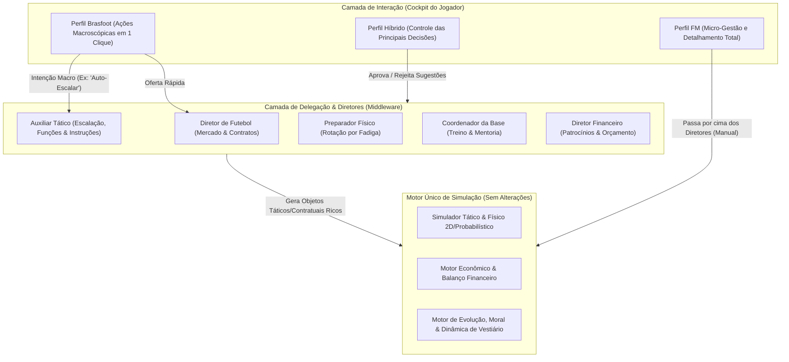

# 🧠 10. Profundidade Progressiva & Sistema de Delegação por Diretores (Brasfoot ⇄ FM)
> **Master Plan Arquitetural: Fluidez de Jogabilidade sem Comprometer o Motor**  
> *Data: Setembro de 2026*

---

## 1. Visão Executiva e O Grande Desafio

O maior desafio de design em jogos de gestão de futebol é o conflito de perfis de jogadores:
* **Perfil Arcade / Dinâmico (Brasfoot / Elifoot):** Velocidade, dopamina instantânea, escalação em 1 clique, compra e venda direta, avançar 5 temporadas em uma tarde sem atrito.
* **Perfil Simulação / Estratégico (Football Manager):** Micro-gestão, instruções detalhadas por jogador, gatilhos de pressão, cláusulas contratuais complexas, mentoria na base e relatórios de scout profundos.

### O Princípio Fundamental da Arquitetura:
> **O Motor de Simulação (`packages/shared/src/simulation`) NUNCA é simplificado ou bifurcado.**
> A física, os atributos, os cálculos táticos, a fadiga, o moral e a matemática de mercado rodam sempre em sua capacidade máxima e determinística.
> 
> **A fluidez é conquistada na Camada de Abstração (Cockpit do Treinador)**, onde a **Diretoria e a Comissão Técnica (Staff)** atuam como **Middleware Inteligente** que traduz intenções simples e rápidas do jogador em instruções ricas e completas para o motor.



---

## 2. Os 3 Níveis de Experiência (Presets de Jogo)

O jogador pode escolher seu perfil na criação do save, alterar a qualquer instante nas **Opções de Jogo**, ou customizar responsabilidade por responsabilidade.

| Dimensão | Modo Brasfoot (Dinâmico / Arcade) | Modo Híbrido (Equilibrado) | Modo Football Manager (Simulação Total) |
| :--- | :--- | :--- | :--- |
| **Prancheta / Tática** | Formação + 3 Sliders Macro (Mentalidade, Ataque, Pressão). 1 botão "Escalar Melhores". | Formação + Estilo de Jogo + Funções Chave com sugestões do Auxiliar. | Mapa de calor, funções individuais, gatilhos de desarme por setor, instruções ao adversário. |
| **Partida ao Vivo** | Simulação ultrarrápida / Ticker simples com botão de substituição rápida no intervalo. | Linha do tempo com lances capitais, gráficos de posse/finalizações e pausas táticas sugeridas. | Visualizador 2D / Scout minuto a minuto, micro-ajustes durante o lance, instruções à beira do campo. |
| **Mercado & Contratos** | Proposta Direta (Valor à vista + Salário sugerido). Botão "Deixar Diretor Negociar". | Negociação em até 3 rodadas com contrapropostas guiadas pelo Diretor. | Mesa de negociação minuciosa (luvas, parcelamento, cláusulas de desempenho, % de revenda). |
| **Categorias de Base** | Notificação simples: *"Jovem pronto para o profissional"*. Botão "Promover". | Reunião mensal com o Coordenador mostrando evolução e recomendações. | Focos de treino individuais, mentoria 1-para-1 com veteranos, controle do sub-20. |
| **Fisiologia & Fôlego** | Alerta visual simples: jogador cansado é poupado automaticamente pelo Preparador se configurado. | Relatório de risco de lesão antes da rodada. | Carga de treino semanal, estresse muscular, período de recuperação e infiltrações. |

---

## 3. O Papel dos Diretores como "Tradutores de Complexidade"

Nos modos simplificados, os diretores **não são apenas cosméticos**: eles resolvem a complexidade nos bastidores. A qualidade do diretor contratado (Bronze, Prata, Ouro, Diamante) determina a precisão dessa automação.

### 1. Auxiliar Tático (`TACTICAL_ASSISTANT`)
* **No modo Brasfoot:** O player apenas escolhe a formação (ex: `4-3-3`) e a mentalidade (`OFENSIVO`). 
* **O que o Auxiliar faz nos bastidores:**
  1. Analisa as melhores características dos 11 titulares (ex: se o lateral tem drible alto, atribui a função `ALA_OFENSIVO`; se o volante tem desarme alto, atribui `PRIMEIRO_VOLANTE`).
  2. Ajusta as entrelinhas de passe e linhas de impedimento adequadas para a formação.
  3. Durante a partida, se um jogador for expulso ou lesionado, o Auxiliar prepara imediatamente a melhor substituição de emergência em 1 clique.

### 2. Diretor de Futebol (`FOOTBALL_DIRECTOR`)
* **No modo Brasfoot:** O player clica em um jogador listado e clica em *"Comprar"*.
* **O que o Diretor faz nos bastidores:**
  1. Calcula a proposta ótima dentro do teto orçamentário.
  2. Negocia cláusulas protetivas (blindagem de multa rescisória para evitar aliciamento da máquina).
  3. Gerencia automaticamente a renovação de reservas úteis que estão a 6 meses do fim do contrato (evitando perdas por lei Bosman sem incomodar o jogador com micro-tarefas).

### 3. Coordenador da Base (`YOUTH_COORDINATOR`)
* **No modo Brasfoot:** O jogador não precisa gerenciar treinos semanais.
* **O que o Coordenador faz nos bastidores:**
  1. Detecta a carência do elenco profissional e orienta o foco de treino da promessa para suprir essa posição.
  2. Atribui automaticamente um veterano de mesma posição com alta liderança como tutor (sistema de Tutoria/Mentoria).

### 4. Preparador Físico (`FITNESS_COACH`)
* **No modo Brasfoot:** Com a opção *"Auto-Poupar Atletas Exaustos"* ligada, ele substitui automaticamente jogadores com fôlego abaixo de 70% por reservas equivalentes antes do apito inicial.

---

## 4. Matriz de Responsabilidades (Painel de Delegação)

Para dar flexibilidade total, o jogador pode personalizar livremente a autonomia de cada setor:

```
+-----------------------------------------------------------------------------------+
|  PAINEL DE DELEGAÇÃO E COMISSÃO TÉCNICA                                           |
+-----------------------------------------------------------------------------------+
|  [ PRESET RÁPIDO: ( ) Brasfoot / Dinâmico   ( ) Híbrido   ( ) Football Manager ]  |
+-----------------------------------------------------------------------------------+
|                                                                                   |
|  DEPARTAMENTO DE FUTEBOL (Diretor: Roberto Silveira - ⭐⭐⭐⭐ Ouro)                |
|  ├─ Negociações de Contratação:    [ (X) Eu Decido  ( ) Diretor Conduz ]          |
|  ├─ Renovação de Elenco Reserva:   [ ( ) Eu Decido  (X) Diretor Conduz ]          |
|  └─ Definição de Multas e Bônus:   [ ( ) Eu Decido  (X) Diretor Conduz ]          |
|                                                                                   |
|  COMISSÃO DE CAMPO (Auxiliar: Marco Moretti - ⭐⭐⭐ Prata)                         |
|  ├─ Escalação dos 11 Iniciais:     [ (X) Eu Decido  ( ) Auxiliar Sugere/Escala ]  |
|  ├─ Funções Individuais (Papéis):  [ ( ) Eu Decido  (X) Auxiliar Otimiza ]        |
|  └─ Substituições de Emergência:   [ ( ) Eu Decido  (X) Auxiliar Prepara ]        |
|                                                                                   |
|  CATEGORIAS DE BASE (Coordenador: Carlos Fontana - ⭐⭐⭐⭐ Ouro)                   |
|  ├─ Promoção de Promessas:         [ (X) Eu Decido  ( ) Coordenador Promove ]     |
|  └─ Mentoria e Foco de Treino:     [ ( ) Eu Decido  (X) Coordenador Conduz ]      |
|                                                                                   |
+-----------------------------------------------------------------------------------+
```

---

## 5. Arquitetura de Código (Zero Impacto no Motor)

### 1. Novo Domínio: Matriz de Delegação (`packages/shared/src/domain/delegation.ts`)
```typescript
export type DelegationPreset = 'BRASFOOT' | 'HYBRID' | 'FOOTBALL_MANAGER' | 'CUSTOM';

export interface ClubDelegationConfig {
  preset: DelegationPreset;
  responsibilities: {
    tacticsLineup: 'MANAGER' | 'ASSISTANT';
    tacticsRoles: 'MANAGER' | 'ASSISTANT';
    transfersIn: 'MANAGER' | 'DIRECTOR';
    contractRenewals: 'MANAGER' | 'DIRECTOR';
    youthDevelopment: 'MANAGER' | 'COORDINATOR';
    fitnessRotation: 'MANAGER' | 'FITNESS_COACH';
    sponsorships: 'MANAGER' | 'FINANCIAL_DIRECTOR';
  };
}
```

### 2. Tradutores de Intenção do Staff (`packages/shared/src/domain/staffAutomation.ts`)
Funções puras que recebem a intenção simples do usuário + o estado do clube + o staff e geram os objetos complexos exigidos pelo motor:
* `staffOptimizeLineupAndRoles(club, formation, mentality, assistant): Lineup & Tactic`
* `staffCreateTransferOffer(targetPlayer, club, director): TransferProposal`
* `staffAutoRenewExpiringContracts(club, director): ContractRenewalAction[]`

### 3. UI Adaptativa no Frontend (`packages/web`)
* **Modo de Exibição Dinâmico (`UiViewModeContext`):** Permite que qualquer tela (Escalação, Mercado, Ao Vivo) alterne instantaneamente entre a **"Visão Expressa"** (cards limpos, sliders simples e botões de 1 clique) e a **"Visão Detalhada"** (tabelas densas, filtros avançados e formulários com abas).
* Um botão de alternância discreto no topo de cada tela (`[ ⚡ Modo Rápido / 🔍 Modo Completo ]`) garante que o jogador possa aprofundar apenas quando quiser.

---

## 6. Roteiro de Execução por Fases
* **Fase 1 (Estrutura & Presets):** 🟢 Concluído (`StaffDelegationConfig`, `ManagerStyleQuizModal`, tela de Responsabilidades).
* **Fase 2 (Automações de Domínio - Itens 1 a 4):** 🟢 Concluído (`computeDirectorTransferRecommendations`, `identifyExpiringContracts`, `calculatePlayerInjuryRisk`, `youthAcademy.ts`).
* **Fase 3 (Integração de UI & CT):** 🟢 Concluído (Cards do Diretor, Banner de Contratos, Alerta de Lesão no Pré-Jogo, Toggle Simples/FM no CT).
* **Fase 4 (Avanço Rápido de Calendário - Item 5):** 🟢 Concluído (`fastAdvance.ts`, `FastAdvanceButton.tsx`).
* **Fase 5 (Reconhecimento de Oposição & Dossiê Scout - Passo 3):** 🟢 Concluído (`oppositionScout.ts`, `OppositionDossierCard.tsx`, integração completa no pré-jogo).
* **Fase 6 (Relatório Causal Pós-Jogo & Papéis Táticos - Passo 4):** 🟢 Concluído (`tacticalMatchReport.ts`, `TacticalRolePerformanceCard.tsx`).
* **Fase 7 (Coletiva de Imprensa Causal & Reativa - Passo 5):** 🟢 Concluído (`pressConference.ts`, `PressConference.tsx` com credenciais Stadium Night e delegação ao auxiliar).
* **Fase 8 (Campinho Tático Dinâmico & Prancheta Interativa - Passo 6):** 🟢 Concluído (`PitchField.tsx`, `PitchPartnershipLines`, `PlayerFunctionPill`, `PartnershipSummaryBar`).
* **Fase 9 (Visualizador Ao Vivo & Assistente de Beira de Campo - Passo 7):** 🟢 Concluído (`TouchlineAssistantCard.tsx`, `LiveMatch.tsx` com intervenção em 1 clique).
* **Fase 10 (Radar Poligonal de Atributos & Comparador Tático - Passo 8):** 🟢 Concluído (`PlayerRadarChart.tsx`, `PlayerComparisonModal.tsx`, integração em `Squad.tsx` e `Transfers.tsx`).
* **Fase 11 (Hierarquia do Vestiário & Reunião de Capitães - Passo 9):** 🟢 Concluído (`LockerRoom.tsx`, `lockerRoom.ts`, `computeSocialGroupsSummary`, `resolvePlayerConcernWithLeader`).
* **Fase 12 (Mentoria 1-para-1 & Treino Setorial - Passo 10):** 🟢 Concluído (`mentorship.ts`, `Training.tsx`, afinidade mentor-aprendiz, auto-atribuição e treino em bloco por linhas).

---

## 7. Módulos e Arquivos Implementados no Monorepo

| Módulo | Arquivos Principais | Responsabilidade |
|---|---|---|
| **Configuração & Presets** | `packages/shared/src/domain/club.ts` | Interface `StaffDelegationConfig` (`autoLineup`, `scoutingAutomation`, `contractRenewals`, `injuryRehab`, `presetMode`). |
| **Mercado & Olheiro (Item 1)** | `packages/shared/src/domain/transferMarket.ts`, `TransferMarket.tsx` | Sugestões automáticas por carência de elenco com propostas 1-clique vs relatório FM. |
| **Contratos em Lote (Item 2)** | `packages/shared/src/domain/contractRenewalAutomation.ts`, `Squad.tsx` | Identificação de contratos críticos (<10 semanas) e renovação atômica em lote. |
| **Saúde & Fisioterapia (Item 3)** | `packages/shared/src/domain/medicalDepartment.ts`, `Tactic.tsx` | Risco preditivo de lesão, banner de advertência no vestiário e botão "Poupar em Risco". |
| **Base & Treinamento (Item 4)** | `packages/shared/src/domain/youthAcademy.ts`, `Training.tsx` | Promoção automática de promessas com teto de 30 vagas e CT adaptativo. |
| **Avanço Rápido (Item 5)** | `packages/shared/src/domain/fastAdvance.ts`, `FastAdvanceButton.tsx` | Avanço rápido até a partida com verificação atômica de interrupções críticas. |
| **Scout de Oposição & Dossiê (Passo 3)** | `packages/shared/src/domain/oppositionScout.ts`, `OppositionDossierCard.tsx` | Reconhecimento de presets adversários, análise de linha defensiva, rest defence, ameaças e contramedidas táticas. |
| **Relatório Pós-Jogo & Papéis (Passo 4)** | `packages/shared/src/domain/tacticalMatchReport.ts`, `TacticalRolePerformanceCard.tsx` | Avaliação de eficácia tática causal e desempenho por papel tático. |
| **Coletiva Causal & Reativa (Passo 5)** | `packages/shared/src/domain/pressConference.ts`, `PressConference.tsx` | Perguntas e respostas dinâmicas baseadas em estatísticas e táticas do confronto pós-jogo com delegação ao staff. |
| **Prancheta & Parcerias Táticas (Passo 6)** | `packages/web/src/components/PitchField.tsx` | Linhas de química entre pares titulares, badges de sub-função, toggle Simples ⇄ FM e barra de entrosamento setorial. |
| **Assistente de Beira de Campo (Passo 7)** | `packages/web/src/components/TouchlineAssistantCard.tsx`, `LiveMatch.tsx` | Recomendações ao vivo para fadiga, cartões amarelos e vulnerabilidades táticas com ação em 1 clique. |
| **Radar Poligonal & Comparador (Passo 8)** | `packages/web/src/components/PlayerRadarChart.tsx`, `PlayerComparisonModal.tsx` | Polígono SVG de 6 eixos, sobreposição de 2 atletas, barras comparativas e veredito automático do olheiro. |
| **Vestiário, Grupos & Capitães (Passo 9)** | `packages/web/src/pages/LockerRoom.tsx`, `lockerRoom.ts` | Pirâmide de 4 degraus, mapa de grupos sociais/afinidades e mediação direta de capitães para resolver insatisfações. |
| **Mentoria 1-para-1 & Treino Setorial (Passo 10)** | `packages/shared/src/domain/mentorship.ts`, `packages/web/src/pages/Training.tsx` | Compatibilidade mentor-promessa (idade, liderança, mesma posição/país), auto-atribuição e treino em bloco por linhas (Defesa, Meio, Ataque). |


